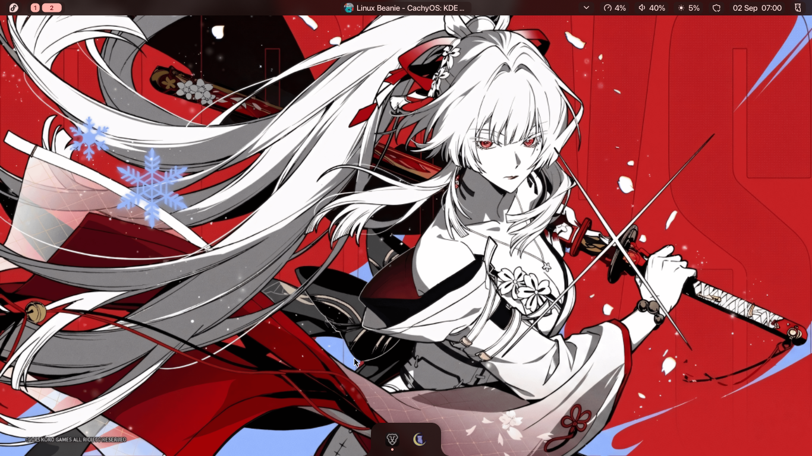

# Fedora Minimal — Niri + Noctalia Shell + macOS Aesthetic Dotfiles



Repository dotfiles & automated deployment script untuk lingkungan desktop Wayland minimalis, modern, dan elegan berbasis **Fedora Minimal / Everything**, **Niri Compositor**, dan **Noctalia Shell v5**.

---

## ✨ Features & Setup Overview

* **Compositor**: [Niri](https://github.com/YaLTeR/niri) (Scrollable-tiling Wayland compositor, Spring physics, Gaps 5px, Borderless, Click-to-focus, CSD disabled).
* **Shell & Top Bar**: [Noctalia Shell v5](https://noctalia.dev) (Single top bar 26px, Capsule pills, Live CPU sysmon, Tray drawer, Network signal & Clock, Control Center).
* **Dock**: Minimalist bottom floating dock with auto-hide (`enabled = true`, `smart_auto_hide = true`).
* **Theming**: Dynamic Material You palette (`m3-content`) extracted from wallpaper + Catppuccin & Tokyo-Night high contrast support.
* **App Auto-Theming**: Alacritty, GTK 3/4, Niri, dan Starship otomatis tersinkronisasi warnanya dengan wallpaper.
* **Typography**:
  * UI: **Apple SF Pro Display 11**
  * Documents: **Apple SF Pro Text 11**
  * Monospace / Terminal: **Apple SF Mono 11**
  * International & CJK: Google Noto Sans/Serif CJK, Noto Color Emoji, Symbols, Asian Scripts suite.
* **Icons & Cursor**:
  * Icons: **WhiteSur-dark** (macOS Big Sur / Sequoia style squircle icons).
  * Cursor: **macOS Cursors 22px** (`macOS` official pointer).
* **Terminal & Shell**:
  * Terminal: **Alacritty** (Borderles, 85% opacity, SF Mono, Noctalia live color sync).
  * Shell: **Zsh** + **Starship Prompt** (Catppuccin 2-line prompt) + Fastfetch compact system info on launch + Auto-suggestions & Syntax-highlighting.
* **Power & Idle Automation**:
  * **Smart Media-Aware Idle Guard**: Otomatis mendeteksi pemutaran media via MPRIS & Niri:
    * **Video Aktif (Fullscreen/Focused)**: Layar tidak terkunci, DPMS tidak mati, dan laptop tidak sleep.
    * **Audio Latar (Musik/Podcast)**: Layar bisa terkunci (5 menit) & padam (6 menit) untuk menghemat baterai, namun laptop **dilarang sleep** sehingga pemutaran audio tidak terputus.
    * **Idle (Tanpa Media)**: Kunci layar di 5 menit, DPMS mati di 6 menit, suspend otomatis di 15 menit.
  * **Manual Inhibit Toggle**: Pintasan cepat `Mod + Shift + I` untuk menonaktifkan/mengaktifkan kembali idle guard secara manual (misal saat presentasi).
* **Privilege & Network**:
  * Polkit rule untuk NetworkManager Wi-Fi scanning tanpa prompt password admin.

---

## 🔁 Full Reinstall Parity

Repo ini adalah backup lengkap. Setelah reinstall Fedora, jalankan `install.sh` dan semua berikut ikut dipulihkan:

* Berkas konfigurasi Niri, Noctalia, Alacritty, btop, CAVA, GTK, PipeWire, Starship, dan Zsh.
* Font SF Pro dan SF Mono (dibundel di `assets/fonts`, tidak perlu unduh pihak ketiga).
* Wallpaper desktop dan avatar lockscreen (dibundel di `assets/walls`).
* Unit systemd user: swayidle idle/sleep, media-idle-guard, dan battery-alert.
* Entri autostart aplikasi pendukung.
* Dukungan tombol **Caffeine** Noctalia yang menonaktifkan lock, DPMS, dan suspend.

---

## 📂 Repository Structure

```text
.
├── assets/
│   ├── fonts/SF-Pro/               # 47 berkas SF Pro (Display, Text, Rounded)
│   ├── fonts/SF-Mono/              # 12 berkas SF Mono
│   └── walls/                      # Wallpaper one.jpg + avatar lockscreen
├── .config/
│   ├── alacritty/
│   │   ├── alacritty.toml          # Terminal config (SF Mono, opacity 0.85)
│   │   └── themes/noctalia.toml    # Palet warna terminal hasil template Noctalia
│   ├── autostart/                  # NetBird, AB Download Manager, Warp Taskbar
│   ├── btop/
│   │   ├── btop.conf               # Konfigurasi btop
│   │   └── themes/noctalia.theme   # Tema btop generatif Noctalia
│   ├── cava/
│   │   ├── config                  # Konfigurasi visualizer CAVA
│   │   └── shaders/                # Shader bar_spectrum & northern_lights
│   ├── fastfetch/config.jsonc      # Fastfetch ringkas saat terminal dibuka
│   ├── gtk-3.0/settings.ini        # GTK 3 SF Pro & WhiteSur
│   ├── gtk-4.0/settings.ini        # GTK 4 SF Pro & WhiteSur
│   ├── niri/
│   │   ├── config.kdl              # Layout, binds, cursor, autostart
│   │   └── noctalia.kdl            # Warna focus ring, border, tab indicator
│   ├── noctalia/
│   │   ├── config.toml             # Top bar 26px & widget layout
│   │   ├── icons/fedora.svg        # Logo launcher monokrom
│   │   └── palettes/CatppuccinCustom.json
│   ├── pipewire/pipewire-pulse.conf.d/50-block-source-volume.conf
│   ├── systemd/user/               # swayidle, media-idle-guard, battery-alert
│   └── starship.toml               # Prompt Starship (palet noctalia)
├── .local/state/noctalia/settings.toml  # Dock, widget lockscreen, wallpaper, tema
├── scripts/                        # battery-alert, media-idle-guard, ocr-snip, reset-mic-state
├── .zshrc                          # Zsh, alias, plugin, fastfetch saat login
├── install.sh                      # Installer otomatis satu perintah
└── README.md
```

---

## 🚀 One-Line Installation

Jalankan perintah ini di instalasi baru Fedora (Workstation / Minimal / Everything):

```bash
bash <(curl -fsSL https://raw.githubusercontent.com/rodwell311/fedora-niri-noctalia/main/install.sh)
```

Atau clone repo secara manual:

```bash
git clone https://github.com/rodwell311/fedora-niri-noctalia.git ~/dotfiles
cd ~/dotfiles
chmod +x install.sh
./install.sh
```

---

## ⌨️ Keybindings Reference

| Shortcut | Action |
| :--- | :--- |
| `Mod + Return` | Buka Terminal (**Alacritty** + Zsh) |
| `Mod + B` | Buka Web Browser (**Brave Origin**) |
| `Mod + E` | Buka File Manager GUI (**Nautilus**) |
| `Mod + Space` | Buka Application Launcher (**Noctalia**) |
| `Mod + V` | Buka Clipboard Manager History (**Noctalia**) |
| `Mod + Escape` | Buka Power & Session Menu (**Noctalia**) |
| `Mod + Shift + Return` | Buka Wallpaper Picker (**Noctalia**) |
| `Mod + Shift + X` | OCR Screenshot: Salin teks dari layar ke clipboard |
| `Mod + Shift + I` | Toggle Mode Manual Idle / Sleep Inhibit (Stay Awake) |
| `Mod + Q` | Tutup Window Aktif |
| `Mod + Left / Right` | Fokus Kolom Kiri / Kanan |
| `Mod + Shift + Left / Right` | Pindahkan Kolom Window ke Kiri / Kanan |
| `Mod + 1 .. 9` | Pindah ke Workspace 1 .. 9 |
| `Mod + Shift + 1 .. 9` | Pindahkan Window ke Workspace 1 .. 9 |
| `Ctrl + Alt + Escape` | Toggle Keyboard Shortcuts Inhibitor |
